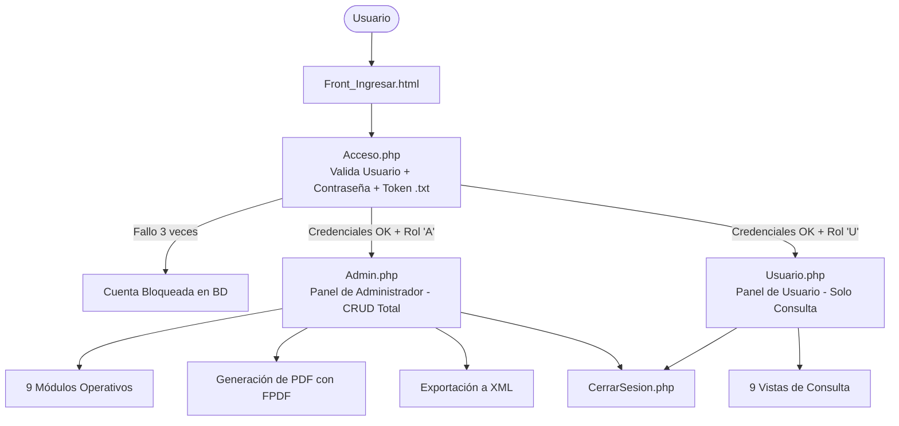

# 🚗 Sistema Integral de Control Vehicular (Querétaro)

[](https://www.php.net/)
[](https://www.mysql.com/)
[](http://www.fpdf.org/)
[](#)

Sistema web integral desarrollado en **PHP** y **MySQL** para la administración, regulación y consulta del padrón vehicular, expedición de licencias, tarjetas de circulación, verificación vehicular e infracciones de tránsito del **Estado de Querétaro**.

---

## 📋 Tabla de Contenidos

1. [Características Principales](#-características-principales)
2. [Arquitectura y Seguridad](#-arquitectura-y-seguridad)
3. [Módulos del Sistema](#-módulos-del-sistema)
4. [Flujo de Navegación y Operación](#-flujo-de-navegación-y-operación)
5. [Estructura del Proyecto y Nomenclatura](#-estructura-del-proyecto-y-nomenclatura)
6. [Requisitos del Sistema](#-requisitos-del-sistema)
7. [Instalación y Puesta en Marcha](#-instalación-y-puesta-en-marcha)
8. [Autores y Créditos](#-autores-y-créditos)

---

## 🌟 Características Principales

* 🔐 **Autenticación Multifactor (2FA por Archivo Físico):** Acceso seguro mediante usuario, contraseña y validación de una llave física/token criptográfico (`.txt`) generado al registrarse.
* 🛡️ **Protección contra Fuerza Bruta:** Bloqueo automático de cuenta tras 3 intentos fallidos consecutivos.
* 👥 **Control de Acceso Basado en Roles (RBAC):**
  * **Administrador (`Tipo = 'A'`):** Control total (Creación, Lectura, Actualización, Eliminación, Impresión de credenciales y exportación XML).
  * **Usuario General (`Tipo = 'U'`):** Acceso restringido en modo consulta a los registros del sistema.
* 📄 **Expedición Oficial en PDF (FPDF):** Emisión e impresión de credenciales físicas de **Licencias de Conducir** y **Tarjetas de Circulación** con dimensiones oficiales, sellos, escudos institucionales, fotografía y firma digital.
* 📑 **Interoperabilidad XML:** Generación automática de comprobantes estructurados en XML al registrar licencias o tarjetas de circulación.
* 📊 **Gestión Completa de 9 Módulos:** Cobertura de todo el ciclo de vida del trámite vehicular.

---

## 🛡️ Arquitectura y Seguridad



### Seguridad y 2FA
1. **Creación de Cuenta (`CrearCuenta.php`):** Al registrar una cuenta se genera un token pseudoaleatorio criptográfico de 16 bytes que se almacena en la base de datos y se descarga automáticamente en el equipo del usuario como `llave[username].txt`.
2. **Inicio de Sesión (`Acceso.php`):** Requiere adjuntar el archivo `.txt` para comparar su contenido contra el registro en la base de datos.
3. **Gestión de Intentos:** Cada intento fallido incrementa el contador de la cuenta. Si llega a 3 intentos, la cuenta queda inhabilitada (`Bloqueo = 1`).

---

## 📦 Módulos del Sistema

El sistema implementa 9 entidades principales con operaciones completas:

| Módulo | Descripción | Funcionalidades |
| :--- | :--- | :--- |
| **🚗 Conductores** | Registro del padrón de automovilistas | Altas, bajas, cambios, grupo sanguíneo, domicilio y datos médicos. |
| **🪪 Licencias** | Control de licencias de conducir | Expedición, vigencias, tipo de licencia, generación de XML e impresión en PDF. |
| **🚙 Vehículos** | Padrón vehicular estatal | Registro de número de serie, modelo, marca, motor y características técnicas. |
| **👤 Propietarios** | Dueños legales de los vehículos | RFC, CURP, razón social o nombre y datos de contacto. |
| **💳 Tarjetas de Circulación**| Documento legal de circulación | Alta y vinculación de vehículo-propietario, placas, holograma, XML y salida en PDF. |
| **💵 Tenencias** | Control de pagos de derechos e impuestos | Registro de ejercicios fiscales pagados y comprobantes. |
| **🏢 Centros de Verificación**| Verificentros autorizados | Catálogo de centros de verificación vehicular en el estado. |
| **🌱 Verificaciones** | Emisiones vehiculares | Registro de dictámenes ecológicos, hologramas aprobados y vigencias. |
| **🚨 Multas** | Sanciones e infracciones de tránsito | Registro de infracciones, folios, motivos y montos aplicables. |

---

## 🗂️ Estructura del Proyecto y Nomenclatura

El código implementa un patrón estructurado con prefijos descriptivos para cada entidad:

```
├── Controlador.php                 # Conexión central a la base de datos MySQL
├── Front_Ingresar.html             # Vista de login con formulario de usuario y archivo token
├── Acceso.php                      # Lógica de autenticación multifactor y enrutamiento
├── FrontCrearCuenta.html           # Vista de registro de nuevos usuarios
├── CrearCuenta.php                 # Generador de token y creador de llaves .txt
├── Admin.php                       # Dashboard administrativo con menús desplegables
├── Usuario.php                     # Dashboard de usuario en modo solo lectura
├── CerrarSesion.php                # Destrucción de variables de sesión
│
├── fpdf.php                        # Librería para creación de documentos PDF
├── font/                           # Fuentes tipográficas utilizadas por FPDF
├── pdf_Licencia.php                # Generador de credencial de licencia en PDF
├── pdf_TarjetaCirculacion.php      # Generador de tarjeta de circulación en PDF
│
├── [Entidad] CRUD:
│   ├── F[Entidad].php              # Formulario para Inserción (Create)
│   ├── I[Entidad].php              # Procesador de Inserción (INSERT SQL)
│   ├── V[Entidad].php              # Consulta para Administradores (Read Admin)
│   ├── V[Entidad]User.php          # Consulta para Usuarios (Read User)
│   ├── CA_[Entidad].php            # Búsqueda por filtros para Actualización
│   ├── FU[Entidad].php             # Formulario precargado para Actualización
│   ├── U[Entidad].php              # Procesador de Actualización (UPDATE SQL)
│   ├── C[Entidad].php              # Búsqueda por filtros para Eliminación
│   └── D[Entidad].php              # Procesador de Eliminación (DELETE SQL)
│
└── Recursos y Assets:
    ├── *.css                       # Hojas de estilo (iniciar_sesion.css, style.css)
    └── *.png / *.jpg               # Logotipos oficiales, escudos, firmas y mapa de Querétaro
```

---

## 💻 Requisitos del Sistema

* **Servidor Web:** Apache (incluido en XAMPP, WampServer o Laragon).
* **PHP:** Versión 7.4 o superior (con extensiones `mysqli` y `fileinfo` habilitadas).
* **Gestor de Base de Datos:** MySQL 5.7+ o MariaDB 10.4+.
* **Navegador Web:** Google Chrome, Mozilla Firefox, Microsoft Edge o compatible.

---

## 🚀 Instalación y Puesta en Marcha

1. **Clonar el repositorio en el directorio web:**
   * Si usas XAMPP en Windows:
     ```bash
     cd C:\xampp\htdocs
     git clone https://github.com/Jonycakes03/Sist_Automotriz.git
     ```

2. **Iniciar los servicios:**
   * Abre el Panel de Control de XAMPP e inicia los módulos de **Apache** y **MySQL**.

3. **Configurar la Base de Datos:**
   * Entra a [phpMyAdmin](http://localhost/phpmyadmin).
   * Crea una nueva base de datos llamada:
     ```sql
     CREATE DATABASE sistemadecontrolvehicular CHARACTER SET utf8mb4 COLLATE utf8mb4_unicode_ci;
     ```
   * Importa las tablas necesarias (`cuentas`, `conductores`, `licencias`, `vehiculos`, `propietarios`, `tarjetasdecirculacion`, `tenencias`, `centrosverificacion`, `verificaciones`, `multas`).
   * Estructura base para la tabla `cuentas`:
     ```sql
     CREATE TABLE cuentas (
         Username VARCHAR(50) PRIMARY KEY,
         Password VARCHAR(100) NOT NULL,
         Tipo CHAR(1) NOT NULL DEFAULT 'U', -- 'A' = Admin, 'U' = Usuario
         Status INT NOT NULL DEFAULT 1,
         Bloqueo INT NOT NULL DEFAULT 0,
         Intentos INT NOT NULL DEFAULT 0,
         Token VARCHAR(64) NOT NULL
     );
     ```

4. **Verificar los parámetros de conexión:**
   * Edita el archivo `Controlador.php` en caso de que tus credenciales de MySQL difieran del estándar de XAMPP:
     ```php
     $Server = "127.0.0.1";
     $Usuario = "root";
     $Pwd = "";
     $BD = "sistemadecontrolvehicular";
     ```

5. **Acceder a la Aplicación:**
   * Abre tu navegador en:
     ```
     http://localhost/Sist_Automotriz/Front_Ingresar.html
     ```
   * Para tu primera prueba, haz clic en **"Crear cuenta"** para obtener tu usuario y descargar automáticamente tu archivo de token de acceso `llave[username].txt`.

---

## 👥 Autores y Créditos

Proyecto desarrollado como parte de la formación en Desarrollo de Sistemas de Información (5to Semestre).

* **Jonathan Suárez** - [*GitHub*](https://github.com/Jonycakes03)
* **Josué**

---

⭐ *Si este proyecto te ha sido de utilidad, no dudes en dejar una estrella en el repositorio.*
